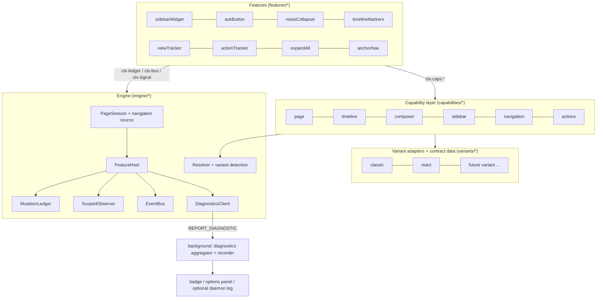

# Design: Extension GitHub DOM Engine

**Status:** Approved (decisions recorded in §14); implementation in progress on branch `refactor/extension-dom-engine`
**Owner:** architect (lead), with tracker (load-more and anchor research), injector (fixture corpus), platform (diagnostics), verifier (review)
**Scope:** `frontend/src/extension/content.ts`, `frontend/src/extension/content/**`, the diagnostics parts of `background.ts` / `options.*` / `types.ts`

**Contents:**
1. Goals and Non-Goals
2. Background
3. Architecture Overview
4. Variants and the DOM Contract
5. Engine
6. Capability Layer
7. Recognition Gate and Fail-Closed Rules
8. Migrating Existing Features
9. Worked Designs: Expand-All and Anchor-Nav Repair
10. Drift Reporting and Recording
11. Testing Strategy
12. File Layout
13. Implementation Plan and Work Packages
14. Open Decisions for the User
15. Appendix: Audit Findings to Structural Fixes

---

## 1. Goals and Non-Goals

### 1.1 Goals (user priorities)

1. **Robust and anti-fragile.**
   - GitHub markup changes degrade OctoDeck features gracefully. They never break, hide or corrupt the GitHub page.
   - Every drift is **reported** to the user (non-intrusively) and **recorded** with enough detail that a developer can update the contract without reproducing the failure.
2. **Adaptable DOM engine with multiple live variants.**
   - Several GitHub markup variants can be live at once: classic Rails PR pages, React issue pages, A/B experiments, and possibly different variants per subtree of one page.
   - Supporting a new variant means adding **data and adapters**, not editing features.
3. **Scales to new features.** Features are written against a small **capability API** (`timeline.items()`, `timeline.loadUntil()`, `composer.submitButton()`, ...), never against selectors. The two planned features, *Expand all comments* and *anchor navigation repair*, must fit without special-casing.
4. **User consulted on user-facing choices.** See §14.

### 1.2 Non-Goals

- **Remote or OTA selector updates.** They create a trust and review problem similar to shipping remote code; contract changes ship as extension releases.
- **Shadow DOM isolation** for injected widgets. OctoDeck widgets are intentionally styled to look native.
- **Changing what the features do**, except where §14 asks the user, e.g. Hide events semantics.
- **Supporting github.com pages other than issues and PRs.** Repo home, notifications and project boards are out of scope.

---

## 2. Background

The current content scripts were audited end to end and cross-checked against two real saved pages:
- **classic Rails PR:** `kubernetes/kubernetes#141014`
- **React issue:** `kubernetes/kubernetes#142957`

The fixtures are being added to `frontend/src/extension/__fixtures__/`. The full appendix of findings is at the end of this document; the headline problems are:

| # | Problem | Evidence |
|---|---|---|
| A | **Unbounded re-injection loop.** Overlapping page transitions leave two live `SidebarSection`s. Their body-wide observers remove and re-insert each other's widget forever. A `sendMessage` callback that arrives after `destroy()` re-injects the Ack button. | Reproduced on the real `content.ts` + issue fixture: ≥503 re-inserts in 1.5s (`content.ts:89-147`, `sidebarSection.ts:231-243, 285-288`) |
| B | **Silent breakage by drift, already happening.** The Ack button never renders on React issue pages. 13 of 15 sidebar selectors and 11 of 14 composer selectors match nothing on either page. Two hashed classes have already rotated (`.row-module__timelineBodyContent__nmY90`, `IssueCommentComposer`). | `sidebarSection.ts:7-40`, `noiseCollapser.ts:428, 483` |
| C | **No detection or reporting of unrecognized DOM anywhere.** Lookups fail silently. Fallbacks such as `.form-actions button[type=submit]` (4 matches on the PR, including review-reply buttons) mutate unfamiliar markup instead of skipping it. | – |
| D | **Hide events fails open.** Anything not positively classified as a comment, close/reopen, review or mention gets `display:none`. Correct on today's markup (0 comment bodies hidden), but a rename would hide all human comments. | `noiseCollapser.ts:834-848` |
| E | **One selector list mixes markup stacks.** The classic PR and the React issue share almost no anchors (12 vs 67 distinct `data-testid`s). Today's code treats 58 rows on the classic PR as items, but there are 30 real items. Some items are **groups**: one `LE_` item holds 8 event rows, one `RFRE_` item holds 7. Rows are the right unit for hiding; whole items are the right unit for collapse runs and marker placement. | §4.1, §6.2 |
| F | **Mutations can't be fully undone.** An inline style on GitHub's node is never reverted. Each feature keeps its own, disagreeing "is this ours?" class list. The sidebar uses GitHub's own classes, so the action tracker treats OctoDeck's own clicks as GitHub actions and fires refetches. | `sidebarSection.ts:291, 558-564`, `actionTracker.ts:336-362` |
| G | **Navigation detection is fragile.** The `history.pushState` patch is dead in the isolated world. React "voltron" pages fire no `turbo:*` events. The `<title>` observer is the only real signal. | `viewTracker.ts:77-103` |

What's worth keeping:
- hiding only through OctoDeck CSS classes
- markers that only insert siblings
- pure classification helpers
- dense previews built with `textContent`

---

## 3. Architecture Overview



**Rule of the layers:**
- Features import only `capabilities/types.ts` and `engine/types.ts`.
- Capabilities import the resolver and variant adapters.
- Only `variants/**` contains GitHub selectors.

A lint test enforces this (§11.5).

---

## 4. Variants and the DOM Contract

### 4.1 What the fixtures show

| Concern | classic (PR #141014) | react (issue #142957) |
|---|---|---|
| Shell | React "voltron" shell (`route-controller=voltron_pull_requests_fragments`) embedding a **Rails** conversation partial | `voltron_issues_fragments`, fully React |
| Timeline container | `.js-discussion` | `ol#issue-timeline[data-testid=issue-timeline-container]` |
| Timeline item | `.js-timeline-item[data-gid]` (30) | `#issue-timeline > li[data-wrapper-timeline-id]` (8/8) |
| Item node id / type | `data-gid` GID prefix | `data-wrapper-timeline-id` GID prefix (`timeline-row-border-<GID>` exists on event rows only, 4/8) |
| Rows inside an item | event groups: inner `[id^=event-]` rows have **no** GID (e.g. `LE_` item = 8 rows, `RFRE_` item = 7) → row kind from the badge octicon class | one row per item |
| Sidebar insertion | before `#partial-discussion-sidebar` (inside `#pr-conversation-sidebar`) | before first `[data-testid^=sidebar-][data-testid$=-section]` inside `[data-testid=issue-viewer-metadata-pane]` |
| Composer submit | `#partial-new-comment-form-actions button.btn-primary[type=submit]` | `[data-testid=comment-composer] button[data-variant=primary]` |
| Author | `a.author` + adjacent `span.Label` "Bot" | `[data-testid=comment-header] a[data-hovercard-type=user]`; events `[data-testid=actor-link]` |
| Body | `.comment-body` | `[data-testid=markdown-body]` |
| Identity | `[data-gid^=PR_]` (11, all equal) | embeddedData `payload.issueViewerRoute.data.repository.issue.id` |
| Load more | `#js-progressive-timeline-item-container form.ajax-pagination-form` ("104 hidden items", "Load more…") | none on this page (short issue); see §9 and tracker research |

The shell and the conversation can differ: the PR page is a React shell around a Rails partial. That's why **variants are detected per scope, not per page**.

### 4.2 Scopes and variant detection

A **scope** is a region whose markup stack can vary on its own:
- `page` (identity, viewer, flags)
- `timeline`
- `sidebar`
- `composer`

Each scope has an ordered list of **variant detectors**. Detection runs per page session and is re-run when the scope's root is replaced (§5.3).

```ts
// dom/types.ts
export type ScopeId = 'page' | 'timeline' | 'sidebar' | 'composer';
export type VariantId = string;                 // 'classic' | 'react' | future ids, declared in variants/index.ts

export interface VariantDetector {
  variant: VariantId;
  /** Selector whose presence identifies this variant's root for the scope; the matched element becomes the scope root. */
  root: Locator;
  /** Optional extra checks (all must match inside root) to disambiguate look-alike variants. */
  confirm?: readonly string[];
}

export interface ScopeDetection {
  scope: ScopeId;
  status: 'recognized' | 'absent' | 'unrecognized' | 'ambiguous';
  variant?: VariantId;
  root?: Element;
  /** Every variant whose root matched; more than one means ambiguous (fail closed) unless the roots are disjoint subtrees (see 4.5). */
  candidates: VariantId[];
}
```

A scope is:
- **absent** when it doesn't apply to the page kind (e.g. no timeline on `/pull/N/files`) or an `absentWhen` predicate holds (signed out → no composer)
- **unrecognized** when it should exist but no detector matched after the settle window

### 4.3 Anchors and locators

An **anchor** is a named DOM landmark that capabilities depend on. Each anchor is declared once, with a **locator per variant**:

```ts
// dom/types.ts
export type Cardinality = 'one' | 'zeroOrOne' | 'oneOrMore' | 'many' | 'allEqual';

export interface Locator {
  /** Ordered: [0] = current primary; later entries = known older or alternate markup (a hit there is reported as drift). */
  selectors: readonly string[];
  /** Resolve relative to another anchor's element instead of the scope root. */
  within?: AnchorId;
  /** Post-match mapping, e.g. "insert before this element" -> el.previousElementSibling target, or the element's parent. */
  map?: (el: Element) => Element | null;
  /** Semantic check on candidates; failures are filtered out before the cardinality check. */
  validate?: (el: Element) => boolean;
  /** For 'allEqual' anchors: value extractor (e.g. data-gid); all matches must agree. */
  value?: (el: Element) => string | null;
}

export interface AnchorDef {
  id: AnchorId;
  scope: ScopeId;
  cardinality: Cardinality;
  presence: Partial<Record<PageKind, 'required' | 'optional' | 'absent'>>;
  absentWhen?: (page: PageFacts) => boolean;
  /** One locator per variant that supports this anchor; a missing entry means "not available in that variant". */
  locators: Partial<Record<VariantId, Locator>>;
}

export type Resolution<E extends Element = Element> =
  | { status: 'ok'; els: E[]; selectorIndex: 0; variant: VariantId }
  | { status: 'fallback'; els: E[]; selectorIndex: number; variant: VariantId }
  | { status: 'missing'; variant: VariantId; expected: boolean }   // expected=false: legitimately absent
  | { status: 'ambiguous'; count: number; selectorIndex: number; variant: VariantId };
```

**Resolver rules** (`dom/resolver.ts`):
- Search only inside the scope root, or the `within` anchor's element.
- Drop candidates inside `[data-octodeck]`, which are our own nodes (§5.5).
- Apply `validate`, then `map`, then check cardinality. **More than one match for `one`/`zeroOrOne` returns `ambiguous`.** The first match is never silently used.
- For `allEqual`, all matched values must agree. Otherwise the result is `ambiguous`.
- Every result that isn't `ok` is passed to the `DiagnosticsClient` together with a structural fingerprint (§10.3).
- Results are memoized per `(generation, anchor, root)`. A `ScopedObserver` notification for that scope (§5.3) invalidates them. Memo hits are re-checked with `isConnected`, because the observer's debounce leaves a stale window.
- Selectors are never built from page or URL data. Ids from a URL hash are looked up with `getElementById` or `CSS.escape`.

### 4.4 Adapters: behavior that isn't a selector

Some variant differences are behavioral, not structural:
- how to trigger Load more and detect when it finishes
- where identity lives (attribute vs embedded JSON)
- how to reveal a collapsed review thread
- how to map an event to an action type

Those go in small **adapter** objects per variant, behind capability-shaped interfaces (§6). A variant module is therefore:

```ts
// variants/types.ts
export interface VariantModule {
  id: VariantId;
  detectors: Partial<Record<ScopeId, VariantDetector>>;
  anchors: Partial<Record<AnchorId, Locator>>;   // merged into AnchorDef.locators at registration
  adapters: {
    page?: PageAdapter;
    timeline?: TimelineAdapter;
    load?: TimelineLoadAdapter;        // section 9.2; separate file per variant so WP1 and WP2 never share a file
    composer?: ComposerAdapter;
    sidebar?: SidebarAdapter;
    actions?: ActionAdapter;
  };
}
// variants/index.ts
export const VARIANTS: readonly VariantModule[] = [classic, react];
```

**Adding a variant**, e.g. a React PR conversation:
1. Add `variants/reactPr/` with detectors, locators and the adapters that differ. Adapters can be reused from `react` by import.
2. Register it in `VARIANTS`.
3. Add a fixture and its `.meta.json`.

No feature file changes.

### 4.5 Coexisting variants

- **Different scopes, different variants.** This is normal: a classic timeline inside a React shell. Each capability instance is bound to its scope's `(variant, root)`.
- **Different pages, different variants.** A/B arms across pages or users are handled for free, because detection runs per page session. Health is aggregated per `feature|variant`, so one arm can degrade alone (§10.4).
- **One scope, two candidate variants on the same page.** The scope is `ambiguous`: mutators fail closed, and `SCOPE_AMBIGUOUS` is reported with the candidates and fingerprints. There's no evidence yet of a page mixing two timeline stacks, so no composite is built.
  - The interfaces leave room for one: `ScopeDetection.candidates` and `TimelineCap` are plain interfaces, so a composite `TimelineCap` over disjoint roots could be added later without feature changes.

### 4.6 Selector hygiene (enforced by tests)

- **Primary selectors** must use ids, `data-testid`, ARIA, `data-*`, semantic tags, Rails `js-*` behavior classes or Primer CSS (`.TimelineItem`, `.Label`).
- **Rejected everywhere:** hashed classes, i.e. `prc-<X>-<Y>-<hash5>` and CSS-module `<name>__<hash>`.
- **Partial class matches** (`[class*=...]`) are allowed only as non-primary fallbacks, and must carry a `// fragile:` comment.
- **English UI text matching** is allowed only inside `variants/**/actions.ts` or classifiers, with `// i18n-fragile`.
- **Every anchor must resolve `ok` in at least one fixture** of each variant that declares it.

---

## 5. Engine

### 5.1 Page sessions and navigation

```ts
// engine/types.ts
export interface PageSession {
  readonly generation: number;
  readonly url: URL;
  readonly facts: PageFacts;          // kind, itemRef, viewer, signedIn, flags (see 6.1)
  readonly signal: AbortSignal;       // aborted when the session ends (navigation, unload, orphaning)
}
```

- `engine/navigation.ts` merges these sources and dedupes them by `location.href`:
  - **Navigation API** `navigation.addEventListener('currententrychange' | 'navigatesuccess')` is the primary source. It covers `pushState`, `replaceState`, hash changes and traversals. Its availability from the isolated world needs one live confirmation, and it's shimmed in tests.
  - Fallbacks: `turbo:load`, `turbo:frame-load`, `popstate`, `hashchange`, and a `<head>` subtree observer (so a replaced `<title>` is tolerated).
  - The merged stream emits `{ kind: 'item-change' | 'subroute-change' | 'hash-change', url }`.
  - Signals that are known not to work are dropped: the `history.pushState` patch, which is dead in the isolated world. `hashchange` and `turbo:load` alone also miss React-router and turbo-frame navigations.
- `item-change` ends the current session (`abort()`, then `ledger.revertAll()`) and starts a new one with `generation + 1`.
- `subroute-change` is e.g. Conversation → Files on the same PR. It also starts a new session, because the page kind changes.
- **`hash-change` doesn't start a new session.** It's published on the bus as `nav:hash` (anchorNav, §9.5).
- **Settling:** the session waits for `DOMContentLoaded` or the first session tick. It then waits up to `SETTLE_MS` (default 8000, matching today's `waitForSidebar`) for each scope's detection to become `recognized` or `absent`, re-evaluating on `ScopedObserver` ticks. A scope that is still unresolved when the window closes becomes `unrecognized`.

### 5.2 FeatureHost and the feature API

```ts
// engine/types.ts
// Shared vocabulary (FeatureId, PageKind, ScopeId, VariantId, AnchorId) is declared in dom/types.ts and re-exported here.
export type FeatureId =
  | 'viewTracker' | 'actionTracker' | 'sidebarWidget' | 'ackButton'
  | 'noiseCollapser' | 'timelineMarkers' | 'expandAll' | 'anchorNav';

export type FeatureKind = 'observer' | 'mutator';
export type FeatureHealth = 'ok' | 'degraded' | 'disabled' | 'notApplicable' | 'unrecognized' | 'off';

export interface FeatureContext {
  readonly session: PageSession;
  readonly signal: AbortSignal;                     // per-mount; aborted on unmount, session end, or circuit-break
  readonly caps: Capabilities;                      // section 6
  readonly ledger: FeatureLedger;                   // section 5.5, pre-bound to this feature
  readonly bus: EventBus;                           // section 5.4
  readonly prefs: PrefsSnapshot & { onChange(cb: (p: PrefsSnapshot) => void): void };
  guard<A extends unknown[]>(fn: (...a: A) => void | Promise<void>): (...a: A) => void; // try/catch + no-op after abort
  onScopeChange(scope: ScopeId, cb: (change: ScopeChange) => void): void;               // section 5.3
  send<T>(msg: ContentMessage): Promise<ExtensionResponse<T>>;                         // no-op/rejects after abort
  report(d: DiagnosticInput): void;                                                     // section 10
  setStatus(s: { health: FeatureHealth; detail?: string }): void;
}

export interface Feature {
  id: FeatureId;
  kind: FeatureKind;
  pages: readonly PageKind[];
  /** Scopes that must be 'recognized' before a mutator mounts (section 7). Observers may declare none. */
  requires: readonly ScopeId[];
  /** Features this one consumes events from (ordering only; no direct references). */
  after?: readonly FeatureId[];
  mount(ctx: FeatureContext): void | Promise<void>;
  /** Optional: everything registered via ctx is torn down automatically; implement only for extra local state. */
  unmount?(): void;
}
```

**What the host guarantees** (`engine/featureHost.ts`):

1. **Lifecycle per generation.**
   - Each mount gets its own `AbortController`. Session end aborts all of them.
   - Everything registered through `ctx` (guards, observers, bus subscriptions, timers via `ctx.guard`, ledger ops, `send` callbacks) becomes a no-op once the mount's signal is aborted.
   - The host never awaits across a generation boundary without re-checking `session.generation`.
   - At most one mount per feature exists at a time.
   
   Together these make bug A impossible, not merely bounded.
2. **Isolation.** Every `mount` and every callback is wrapped with try/catch. One feature's failure never affects another feature or the page.
3. **Circuit breaker.** It trips on either:
   - 3 exceptions within 30s, or
   - a **re-inject budget** exceeded: more than 5 (re)insertions of the same own node within 10s, counted by the ledger. That's the signature of an observer ping-pong or of fighting React reconciliation.
   
   Tripping aborts the mount, reverts its ledger entries, sets the health to `disabled`, and reports `FEATURE_DISABLED`. The feature retries on the next session.
4. **Recognition gate.** Before mounting a mutator, every scope in `requires` must be `recognized` (§7). Otherwise the health becomes `unrecognized` or `notApplicable` and the feature doesn't mount.
5. **User switches.** The global Safe mode switch is read from storage (decision 7). There are no per-feature switches in this phase; the `off` health is reserved for them.
6. **Orphan detection.** If `chrome.runtime.id` becomes undefined, or `send` throws "Extension context invalidated", the host aborts everything, reverts the ledger, sets `data-octodeck-safe`, and goes quiet.
7. **Boot hygiene and a single instance.** On start, the engine:
   - writes a fresh instance token to `<html data-octodeck-instance>`
   - removes stale `[data-octodeck]` nodes and `octodeck-gh-*` classes left by an orphaned predecessor
   - clears `data-octodeck-safe`
   
   An older instance whose JS is still alive watches that attribute; when it sees a different token, it aborts and reverts itself. This guarantees no double-mount after an extension update or re-injection.
8. **Prefs never gate DOM features.** `ctx.prefs` (hide events, known bots, feature switches, safe mode) is loaded in parallel with scope detection, with a 1s timeout. On timeout, the cached `localStorage` values are used, then defaults. Later values arrive through `prefs.onChange`.
7. **Health aggregation.** The `FeatureHealth` of each feature is published on the bus (`host:health`). The sidebar widget renders its "Limited" state from it (§14, decision 6), and it's included in diagnostics.

**Mount order:**
1. observers
2. `sidebarWidget`
3. `ackButton`
4. `noiseCollapser`
5. `timelineMarkers`
6. `expandAll`
7. `anchorNav`

The order is only a convenience: `after` declarations decide it, and no feature references another directly.

### 5.3 ScopedObserver

There's a single `MutationObserver` on `document.documentElement` (`childList`, `subtree`), owned by the engine. Observing `<html>` rather than `<body>` survives Turbo body swaps. A swapped `<body>`, or a same-URL `turbo:render`, makes the engine re-detect all scopes.

- Mutation records whose target **and** added/removed nodes are all inside `[data-octodeck]` are dropped. That removes self-triggered work.
- The remaining records are attributed to scopes by checking `scopeRoot.contains(target)`, and coalesced per animation frame plus a trailing debounce (default 150ms).
- A `ScopeChange { scope, addedElements, rootReplaced }` is delivered to subscribers.
- If a scope root is detached, the engine re-runs that scope's detection. If the scope comes back with a different variant, scope-bound capabilities are rebuilt and dependent mutators are remounted.

This replaces the four body-wide observers that exist today: `sidebarSection.ts:123, 243`, `noiseCollapser.ts:971` and `timelineMarkers.ts:304`.

### 5.4 EventBus

The bus is typed, synchronous and per session. Handlers are guarded and auto-unsubscribed on abort.

```ts
export interface BusEvents {
  'item:updated': { item: Item | null; daemon: 'ok' | 'notFound' | 'offline' | 'error'; error?: string }; // sidebarWidget -> ackButton, markers
  'prefs:changed': PrefsSnapshot;
  'timeline:changed': { added: TimelineItem[]; reason: 'mutation' | 'loadMore' | 'live' };
  'timeline:loading': { phase: 'start' | 'batch' | 'end'; loaded: number; remaining: number | null; error?: string };
  'nav:hash': { hash: string };
  /** Synchronous request to un-hide an element OctoDeck itself hid (collapsed noise run or hidden event row). Handlers act before emit() returns. */
  'reveal:request': { target: Element };
  'host:health': Record<FeatureId, { health: FeatureHealth; detail?: string }>;
}
export interface EventBus {
  emit<K extends keyof BusEvents>(k: K, v: BusEvents[K]): void;
  on<K extends keyof BusEvents>(k: K, cb: (v: BusEvents[K]) => void): void; // bound to the caller's ctx.signal
  last<K extends keyof BusEvents>(k: K): BusEvents[K] | undefined;           // replay for late mounters
}
```

### 5.5 MutationLedger: the only way to touch the page

```ts
export interface FeatureLedger {
  /** Creates an element tagged data-octodeck="<feature>" (and data-octodeck-key if given). */
  create<K extends keyof HTMLElementTagNameMap>(tag: K, key?: string): HTMLElementTagNameMap[K];
  insert(node: Element, where: { before: Element } | { after: Element } | { appendTo: Element }): void; // node must come from create()
  addClass(el: Element, cls: `octodeck-gh-${string}`): void;        // on GitHub nodes; recorded for revert
  removeClass(el: Element, cls: `octodeck-gh-${string}`): void;
  setData(el: Element, name: `octodeck-${string}`, value: string): void; // data-octodeck-* only
  remove(node: Element): void;                                        // own nodes only
  revert(): void;                                                     // everything this feature did
}
```

- **Allowed on GitHub nodes:** inserting own siblings or children, adding or removing `octodeck-gh-*` classes, and setting `data-octodeck-*` attributes.
- **Not allowed:** inline styles, removing or moving GitHub nodes, `innerHTML` on GitHub nodes, changing GitHub-owned attributes, or putting GitHub's class names on our nodes.
- **Re-insert counting.** Inserting a node whose `key` was inserted before, after being removed by someone else, counts against the re-inject budget (§5.2).
- **Single revert path.** `host.endSession()` → `ledger.revertAll()`, which runs even if a feature's `unmount` threw.
- **Clones** of GitHub content (dense previews) go through `ledger.cloneForDisplay(el)`, which strips `id`, `for` and `name` attributes and event-handler attributes.

### 5.6 CSS safe mode

All hiding rules in `content/styles/*.css` are gated on a document attribute:

```css
html:not([data-octodeck-safe]) .octodeck-gh-collapsed-comment,
html:not([data-octodeck-safe]) .octodeck-gh-hidden-event { display: none !important; }
html[data-octodeck-safe] [data-octodeck] { display: none !important; }
```

When `data-octodeck-safe` is set on `<html>`, GitHub's original rendering comes back at once even if no JS cleanup runs. The engine sets it on orphaning and when the user enables safe mode (§14, decision 7).

### 5.7 Messaging

`engine/messaging.ts` has one helper: `send(msg, signal)`.
- It checks `chrome.runtime?.id`, wraps the call in try/catch, and maps `lastError` to `{ok:false}`.
- It resolves to a no-op result after `signal` aborts.
- It detects context invalidation (→ orphan handling).

Every content-side `chrome.runtime.sendMessage` call is replaced by `ctx.send`.

---

## 6. Capability Layer

Capabilities are the **only** API features use to read or locate GitHub DOM. They are built per session from the scope detection, and they hide variants, selectors and fallbacks.

```ts
// capabilities/types.ts
export interface Capabilities {
  page: PageCap;
  timeline: TimelineCap | null;     // null when the timeline scope is absent or unrecognized
  composer: ComposerCap | null;
  sidebar: SidebarCap | null;
  navigation: NavigationCap;
  actions: ActionsCap;
}
```

### 6.1 page

```ts
export type PageKind = 'issue' | 'pr-conversation' | 'pr-subtab' | 'other';
export interface ItemRef { owner: string; repo: string; number: number; itemId: string /* owner/repo#n */; nodeId?: string /* I_/PR_ */ }
export interface PageFacts {
  kind: PageKind;
  item: ItemRef | null;
  viewerLogin: string | null;      // meta[name=user-login]
  signedIn: boolean;
  locked: boolean | null;          // null = unknown in this variant
  archived: boolean | null;
  ghRelease: string | null;        // meta[name=release]
  variants: Partial<Record<ScopeId, VariantId>>;
}
export interface PageCap { facts(): PageFacts; }
```

- `kind` comes from the URL: `/pull/N` → `pr-conversation`, `/pull/N/(files|changes|commits|checks)` → `pr-subtab`, `/issues/N` → `issue`.
- `item.nodeId` comes from the page adapter, and is accepted only if it's `allEqual` **and** agrees with the URL's `owner/repo` (`meta[name=octolytics-dimension-repository_nwo]`). Otherwise it's dropped and `DOM_IDENTITY_MISMATCH` is reported. This fixes the audit's identity concern.

### 6.2 timeline

```ts
export type TimelineItemKind =
  | 'comment' | 'review' | 'reviewThread' | 'closeReopen' | 'reference' | 'commit'
  | 'event' | 'description' | 'unknown';

export interface TimelineItem {
  readonly el: Element;            // the whole item: the unit for collapse runs and marker placement
  readonly nodeId: string | null;  // GitHub GraphQL node id (classic data-gid, react data-wrapper-timeline-id)
  readonly kind: TimelineItemKind; // from GID typename prefix (table below); for groups, the item's own GID type, informational only
  readonly anchors: readonly string[]; // DOM ids usable as URL hashes inside this item: issuecomment-N, discussion_rN, pullrequestreview-N, event-N
  /** Rows: the unit for hiding. Single-row items return [one row]; classic event groups return one row per [id^=event-] entry. */
  rows(): readonly TimelineRow[];
  author(): { login: string; isBotHint: boolean; isApp: boolean } | null;
  timestamp(): number | null;
  body(): Element | null;          // markdown body element, read-only
}

export interface TimelineRow {
  readonly el: Element;
  readonly kind: TimelineItemKind; // GID prefix when the row has one, else structural (badge octicon class -> kind table), else 'unknown'
  readonly kindSource: 'gid' | 'structure' | 'heuristic';  // 'heuristic' (text) use is reported as TIMELINE_HEURISTIC_USED
  readonly anchors: readonly string[];
  timestamp(): number | null;
}

export interface LoadResult {
  status: 'loaded' | 'exhausted' | 'timeout' | 'failed' | 'aborted' | 'noProgress';
  added: number;
  batches: number;
}

export interface TimelineCap {
  items(): readonly TimelineItem[];                    // whole items in document order
  supportsLoadMore(): boolean;                         // false for variants whose loader isn't verified (fail closed)
  hidden(): readonly HiddenItemsInfo[];                // section 9.1: ranges, collapsed threads, hidden-comment loaders
  loadMoreControls(): readonly LoadMoreControl[];      // section 9.4: GitHub's own Load more button per range + where our UI goes
  loadUntil(pred: () => boolean, opts: LoadUntilOptions): Promise<LoadResult>;      // shared by expandAll + anchorNav (section 9.3)
  focusedLoad(hash: string, opts: { signal: AbortSignal }): Promise<boolean>;     // GitHub's own anchor loader, if the variant has one
  findByAnchor(hash: string): { item: TimelineItem; target: Element } | null;     // exact id, then suffix + numeric id
  reveal(target: Element | HiddenItemsInfo, opts: { signal: AbortSignal }): Promise<boolean>;
  onItemsAdded(cb: (items: readonly TimelineItem[]) => void): void;               // via ScopedObserver; bound to ctx.signal
}

export interface LoadUntilOptions {
  signal: AbortSignal;
  kinds?: readonly HiddenKind[];   // default ['range']
  maxBatches: number;              // hard bound
  batchTimeoutMs: number;          // per batch
  interBatchDelayMs: number;       // politeness / rate-limit spacing
  onProgress?: (p: { batches: number; added: number; remaining: number | null }) => void;
}
```

**GID typename prefix → kind.** This is a data table in `capabilities/timelineKinds.ts`, seeded from the fixtures:

| Prefix(es) | GitHub type | kind |
|---|---|---|
| `IC_` | IssueComment | `comment` |
| `PRR_` | PullRequestReview | `review` |
| `PRRT_` | PullRequestReviewThread | `reviewThread` |
| `CE_`, `REE_` | Closed/ReopenedEvent | `closeReopen` |
| `CRE_`, `REFE_`/`REF_` | Cross-referenced/ReferencedEvent | `reference` |
| `C_`, `PRC_` | Commit / PullRequestCommit | `commit` |
| `LE_`, `UNLE_`, `AE_`, `UAE_`, `RFRE_`, `RTE_`, force-push, ready/draft, branch, lock, pin, transfer, deploy, project, milestone | hideable events (Hide events allowlist) | `event` |
| other recognized events (e.g. review dismissed, marked duplicate, connected) | non-hideable events | `otherEvent` |
| `PR_`, `I_` (description) | PullRequest/Issue body | `description` |
| *(unrecognized prefix)* | – | `unknown` + `TIMELINE_UNKNOWN_KIND` (info) diagnostic, recorded so the table can grow |

These prefixes are GitHub's structured global-ID type tags, not opaque per-item IDs. Classification no longer depends on English text or badge icons. The current heuristics (`noiseCollapser.ts:313-631`) remain only as a fallback for items without a node ID, and **their use is recorded as drift**.

### 6.3 composer, sidebar

```ts
export interface ComposerCap {
  submitButton(): Element | null;                // the single primary submit of the new-comment composer
  insertionPoint(): { before: Element } | null;  // where an adjacent OctoDeck control goes (variant decides wrapper)
}
export interface SidebarCap {
  insertionPoint(): { before: Element } | { appendTo: Element } | null;
}
```

### 6.4 navigation

```ts
export interface NavigationCap {
  hash(): string;                                          // decoded, without '#'
  onHash(cb: (hash: string) => void): void;                // bus 'nav:hash'
  scrollToAndHighlight(target: Element, opts: { signal: AbortSignal }): void; // ledger class + scrollIntoView; respects prefers-reduced-motion
  // Polite banner toast at the top of the viewport (anchor repair, expand-all progress). Dismissed when `signal` aborts.
  // `ledger` attributes the nodes to the calling feature (default: the engine's anchorNav ledger).
  // `action` adds a native button (e.g. Cancel); clicking it does not dismiss the toast.
  showToast(text: string, opts: { signal: AbortSignal; ledger?: FeatureLedger; action?: { label: string; onClick(): void } }): { update(text: string): void; focusAction(): void; dismiss(): void };
}
```

### 6.5 actions (read-only)

```ts
export type GitHubActionType = 'comment' | 'pr_review' | 'merge' | 'close_reopen' | 'assignee_label';
export interface ActionsCap { classify(event: Event): GitHubActionType | null } // ignores events whose composedPath contains [data-octodeck]
```

Variant `ActionAdapter`s own the selectors and text heuristics that live in `actionTracker.ts:105-494` today. The React issue page has **no `<form>`s**, so its adapter is click- and key-based.

---

## 7. Recognition Gate and Fail-Closed Rules

1. **Mutators mount only when their required scopes are `recognized`.** `absent` means `notApplicable`, which is silent. `unrecognized` or `ambiguous` means don't mount, and report.
2. **Anchors inside a recognized scope:**
   - `ok` → use it
   - `fallback` → use it and report `DOM_ANCHOR_FALLBACK` (info, "drift")
   - `missing` while expected → skip that action, report `DOM_ANCHOR_MISSING`
   - `ambiguous` → skip that action, report `DOM_ANCHOR_AMBIGUOUS`
3. **Hide only what is positively identified.** This is a behavior change (§14, decision 11).
   - Hide events works at **row** granularity. It hides only rows whose `kind` is in an allowlist of noise kinds (`event`, `commit`, ... per the user's decision). It never hides a row of kind `unknown`, `closeReopen`, `reference` or `review`, and never a row containing a markdown body.
   - A grouped item is hidden as a whole only when **every** row in it is hidden. A `CE_`/`CRE_` row inside a noise group therefore stays visible.
4. **Reviews with comments are never collapsed or hidden** (decision 12). An item of kind `review` whose subtree contains any review comment or review body (`body()` non-null, or any `discussion_r*` anchor) breaks noise runs and is excluded from collapsing, whoever the author is (bot or human).
   - Bodiless review events (e.g. "approved these changes" with no text) follow the normal rules.
   - Commit groups and bodiless events can collapse as before.
   - Before hiding, run a **classification sanity check** that looks at evidence of misclassification, not at ratios: if a row with a body has kind `unknown`, or a heuristic (text) `kindSource` was used, or a comment-body element sits inside an item whose kind isn't `comment`/`review`/`description`, skip hiding for this pass and report `DOM_CLASSIFY_ANOMALY`. Ratio rules (e.g. "0 comments" or ">80% hidden") are deliberately not used: Dependabot/Renovate and label-heavy bot PRs trip them legitimately.
5. **Identity writes** (ack, star, notes) use `ItemRef` validated as in §6.1. Daemon responses whose item doesn't match `owner/repo#number` are rejected and reported.
6. **Legitimate absence is declared, never inferred.** Page kind, `absentWhen` (signed out, locked, archived) and scope `absent` status cover it. Anything not declared is drift.

---

## 8. Migrating Existing Features

| Feature (new file) | Today | Capabilities used | Notes |
|---|---|---|---|
| `features/viewTracker.ts` (observer) | `content/viewTracker.ts` | `page`, session start, `document.visibilityState` | Records a view only after the tab has been visible **and** focused for `VIEW_DWELL_MS = 3000` (a named constant). A background tab that later becomes visible and focused for 3s counts. Hash-only changes don't count (decision 18). Throttling unchanged. |
| `features/actionTracker.ts` (observer) | `content/actionTracker.ts` | `actions.classify`, `ctx.send` | Self-event filter is built into `ActionsCap`. Sync scheduling is unchanged. |
| `features/sidebarWidget.ts` (mutator; requires `sidebar`) | `SidebarSection` | `sidebar.insertionPoint`, `page.facts`, `ctx.send`, bus `item:updated` (emits) | Own classes only. Renders the "Limited" state from `host:health`. Keeps its own rendering (template + `escapeHtml`). |
| `features/ackButton.ts` (mutator; requires `composer`) | `SidebarSection.renderCommentAck` | `composer.insertionPoint`, bus `item:updated` | Split from the sidebar, so each fails independently. No inline style; the CSS class goes on our own node. |
| `features/noiseCollapser.ts` (mutator; requires `timeline`) | `NoiseCollapser` | `timeline.items`, `item.rows()`, `onItemsAdded`, `item.kind/author/body`, `ledger.cloneForDisplay` | Collapse runs are made of **whole items**; hiding is per **row** (§7). Incremental on `timeline:changed`. Handles `reveal:request` by expanding the run or row that contains the target. |
| `features/timelineMarkers.ts` (mutator; requires `timeline`) | `TimelineMarkers` | `timeline.items`, `item.timestamp`, bus `item:updated`, `timeline:changed` | Markers go between whole items only. |
| `logic/timelineClassify.ts` (pure) | helpers in `noiseCollapser.ts` | – | `isBotLogin`, `isSlashCommandBody`, run grouping, `buildCollapseSummaryText`, `calculateTimelineMarkerIndices` move here unchanged and stay unit-tested. |

`content.ts` shrinks to building the engine, registering the variants and features, and starting it.

---

## 9. Worked Designs: Expand-All and Anchor-Nav Repair

The variant mechanics below come from tracker's research on the fixtures and GitHub's own bundled JS (`behaviors.js`):
- Classic is well understood.
- **The React issue's Load more UI hasn't been observed yet** (the fixture has 11 items). Until a large-issue capture exists, the React `TimelineAdapter` reports load-more as **unsupported**, which fails closed (§9.4).

### 9.1 Hidden content model

`timeline.hidden()` returns every place where GitHub is holding content back:

```ts
export type HiddenKind = 'range' | 'collapsedThread' | 'hiddenComments';
export interface HiddenItemsInfo {
  kind: HiddenKind;
  segment: Element;               // the control's container (read-only to features)
  count: number | null;           // hint only (parsed digits); never required
  /** Numeric comment ids GitHub says live inside (classic data-hidden-comment-ids); lets anchor-nav target precisely. */
  containsCommentIds?: readonly string[];
}
```

| Kind | classic (`variants/classic/load.ts`) | react |
|---|---|---|
| `range` | `#js-progressive-timeline-item-container form.js-ajax-pagination` ("104 hidden items" / "Load more…"). There's one hidden middle range between the front and back segments. Review threads load hidden replies through the same `form.js-ajax-pagination` (marked `.js-thread-hidden-comment-ids`, button "Load more…" with no count); those are `hiddenComments`, never `range`. | Probed from `react-app.embeddedData` `timelineItems{totalCount,beforeFocusCount,afterFocusCount,pageInfo}` (a load-time snapshot, detection only). The control is unknown until captured. |
| `collapsedThread` | `review-thread-collapsible[data-hidden-comment-ids]` (2 in the fixture, with no `discussion_r` inside until opened) | n/a |
| `hiddenComments` | `.js-thread-hidden-comment-ids`, `.js-review-hidden-comment-ids` forms (long threads and reviews; 0 in the fixture) | n/a |

### 9.2 Adapter contract for loading

```ts
// variants/types.ts
export interface TimelineLoadAdapter {
  supportsLoadMore(): boolean;
  hidden(root: Element): HiddenItemsInfo[];
  /** Trigger GitHub's own control for one segment and resolve when GitHub has finished (or failed). */
  loadOne(seg: HiddenItemsInfo, opts: { signal: AbortSignal; timeoutMs: number }): Promise<'loaded' | 'ended' | 'failed' | 'timeout' | 'aborted'>;
  /** Optional: ask GitHub's own anchor loader for one focused item (classic: synthetic hashchange). */
  focusedLoad?(hash: string, opts: { signal: AbortSignal; timeoutMs: number }): Promise<boolean>;
  /** Open a collapsed container around a target (click the toggle button; never call custom-element methods). */
  reveal(target: Element, opts: { signal: AbortSignal }): Promise<boolean>;
  /** Optional: where an adjacent OctoDeck control goes, given the range's resolved timeline.loadMoreControl (null = unverified markup). */
  controlInsertionPoint?(control: Element): InsertionPoint | null;
}
```

**Classic `loadOne` rules** (from `@github/remote-form` behavior):
- **Trigger:** click the form's submit button (or `form.requestSubmit(button)`). That dispatches a real `submit` event, which GitHub's main-world handler intercepts, then fetches and splices the content.
- **Never** `form.submit()`: it navigates away. **Never** fetch `timeline_more_items` ourselves.
- **Skip** while the button is `disabled` (`data-disable-with`, in flight).
- **Success:** the clicked form becomes `!isConnected`, and ≥1 new `[data-gid]` item appears in its place. `page:loaded` fires on the *detached* form, so listen on the form itself or watch the parent.
- **`ended`:** the form is removed and 0 items were added (404).
- **`failed`:** the form is still connected after the button re-enables, or `timeoutMs` passes (default 15s).
- **Stale cursor:** the new form's `action` is the same as the old one → `failed`, so we never loop.

**Custom elements:** content scripts can't call main-world custom-element methods such as `review-thread-collapsible.open()`. `reveal` clicks `button[data-target="review-thread-collapsible.button"]` or `<summary>` instead.

**React:** `supportsLoadMore()` returns `false` until the capture lands. `reveal` handles `<details>` only.

### 9.3 Shared primitive: `timeline.loadUntil(pred, opts)` (`capabilities/loadUntil.ts`)

```
acquire session load mutex (expand-all and anchor-nav never click concurrently)
batches = 0
loop:
  if signal.aborted -> 'aborted'
  if pred() -> 'loaded'
  if document.hidden -> await visible (abortable)
  if composer has focus -> await blur (abortable)      // never steal focus while the user types
  seg = first hidden() of the kinds allowed by opts (default: ['range'])  -> none: 'exhausted'
  snapshot = set of item nodeIds; anchorEl = first item in viewport + its top
  r = adapter.loadOne(seg, {signal, timeoutMs})
  restore scroll offset of anchorEl if it moved; restore document.activeElement
  added = items() whose nodeId not in snapshot
  r == 'failed'|'timeout' -> report LOADMORE_FAILED{variant, kind, phase} ; return r
  r == 'ended' && added == 0 -> 'exhausted'
  r == 'loaded' && added == 0 -> report LOADMORE_NO_PROGRESS ; return 'noProgress'
  bus.emit('timeline:changed', {added, reason:'loadMore'}); onProgress(...)
  if ++batches >= maxBatches -> 'loaded' (bounded; caller may offer "Continue")
  await delay(interBatchDelayMs, signal)
```

- **Item identity is the node ID (GID).** New items are found by set difference, so items GitHub inserts over its websocket at the end of the timeline (`#partial-timeline.js-timeline-marker`) are handled the same way: the ScopedObserver emits `timeline:changed{reason:'live'}`.
- **Politeness:** strictly sequential, ≥400ms between batches, stop at the first non-success, capped batches per run. This avoids GitHub's secondary rate limit ("Whoa there" / 429) on very large PRs.

### 9.4 Expand all comments (`features/expandAll.ts`, mutator; requires `timeline`)

- **Availability:** `caps.timeline.supportsLoadMore()` and a recognized native control per hidden range. Unsupported variants get the health `notApplicable` with detail `unsupported-variant` and render nothing; it's never guessed.
- **Placement:** an inline **"Load all"** button next to each of GitHub's own "Load more" controls, located through `timeline.loadMoreControls()` (§6.2):
  - The anchor `timeline.loadMoreControl` is resolved *inside* each `range` segment and must match exactly once. Classic: `form.js-ajax-pagination button[type="submit"][data-disable-with]` (only the "Load more…" button carries GitHub's in-flight label; the "N hidden items" button doesn't). React declares no locator (§9.2), so nothing renders there.
  - The variant's `TimelineLoadAdapter.controlInsertionPoint(control)` picks the slot. Classic: right after the "Load more…" button, inside the form's button column. Our button is `type="button"`, so it never submits the form and never matches the adapter's submit-button reads.
  - A range without exactly one control, or a control without a verified slot, is skipped (fail closed) and reported once per session as `DOM_ANCHOR_MISSING` / `DOM_ANCHOR_AMBIGUOUS` on `timeline.loadMoreControl`.
  - The button follows the ranges: it re-renders on every timeline scope change and `onItemsAdded`, and is removed when its range is gone. Each segment element gets its own keyed button, so GitHub replacing the form after a load never counts against the ledger's re-inject budget, while re-inserting a button someone removed from a still-present segment does.
- **Run:** `loadUntil(() => false, { kinds: ['range'], maxBatches: 25, batchTimeoutMs: 15000, interBatchDelayMs: 400, signal })`.
  - While it runs, the inline buttons are withdrawn and a banner toast (`navigation.showToast` with the feature's own ledger, §6.4) shows "Loading N hidden items…", then "… M remaining" from `onProgress`, with a **Cancel** button.
  - The toast follows the run's AbortSignal, so it disappears at once on Cancel, navigation, or `unmount`; every other ending dismisses it explicitly (including a thrown loader).
  - Focus: activating a focused "Load all" moves focus to the toast's Cancel (`focusAction()`); when such a run ends with focus still on our nodes (or fallen back to `<body>`), it moves to the re-rendered inline button with `preventScroll`, so the page never jumps back. Runs that didn't take focus never move it, and focus the user moved elsewhere is never taken.
  - On `bounded` (batch cap reached) a short result toast says more remain and the inline button reads "Continue loading all". On `exhausted` the result toast reports how many items loaded. Result toasts disappear after 4 s; a cancelled run shows none.
  - Whether expand-all also opens `collapsedThread`s (resolved or outdated review threads that GitHub collapses on purpose) is decision 16.
- **Interaction:**
  - `noiseCollapser` defers regrouping while `timeline:loading` is active and regroups once at `end`, processing only the new GIDs.
  - `timelineMarkers` recomputes after each batch, because the Last Viewed position may now fall in a newly loaded range.
  - `actionTracker` classifies these clicks as `null` (GitHub's control is on its ignore list; our button is an own node).
- **Failure:** the result toast says "Couldn't load more hidden items", the health is `degraded` (`load-<status>`) and the inline button stays for a retry. A diagnostic is recorded with variant and phase. Nothing is mutated except by GitHub's own loader and our own nodes.
- **To verify live:** whether loading the hidden range affects GitHub's unread or notification-read state (`js-timeline-marker`, `X-Timeline-Last-Modified`).

### 9.5 Anchor navigation repair (`features/anchorNav.ts`, mutator; requires `timeline`)

**Probable root cause** (to be confirmed with capture 2 in §11.1):
- GitHub's classic anchor loader (`behaviors.js` `nA`/`n_`) runs only at DOM-ready, on `hashchange`, and on Turbo/PJAX success.
- On voltron pages the Rails conversation partial (`<rails-partial>`) is inserted **after** DOM-ready, and React-router links change the hash with `pushState`, which fires no `hashchange`.
- So GitHub's loader never sees the partial.

**Algorithm.** It runs on session settle with a hash, and on every `nav:hash` with `kind: 'hash-change'` (§5.1). A newer hash aborts an in-flight repair.

1. **Parse** with `capabilities/anchorKinds.ts`: `issuecomment-N`, `discussion_rN`, `pullrequestreview-N`, `event-N`, `issue-N` / `pullrequest-N`, `ref-pullrequest-N`, `commits-pushed-<sha>`. Unknown hashes (`#diff-…`, user-content headings) are ignored.
2. **Find:** `timeline.findByAnchor(hash)` matches the exact id, then by **suffix + numeric id**, because React variants can prefix anchor ids (`commentAnchorPrefix`). If found:
   1. `bus.emit('reveal:request', {target})`, so anything OctoDeck itself collapsed or hid gets expanded. noiseCollapser handles this; anchorNav never references it.
   2. `timeline.reveal(target)`, for GitHub's own collapsed threads or `<details>`.
   3. Scroll (with the sticky-header offset), then highlight. **Done.**
3. **Collapsed container:** if a `hidden()` entry's `containsCommentIds` includes the numeric id, call `reveal(seg)`, wait up to 5s for the id, then go to step 2.
4. **GitHub's own focused loader** (classic only, `focusedLoad`): if `#js-timeline-progressive-loader[data-timeline-item-src]` exists, dispatch one synthetic `HashChangeEvent('hashchange')`. GitHub then issues one focused request and splices the item in itself. Wait up to 5s. One request, versus N for load-more.
   - Side effect: GitHub's other `hashchange` listeners re-run as well; the ones observed are idempotent.
   - Whether to use this nudge is decision 17.
5. **Bounded load-more:** `loadUntil(() => findByAnchor(hash) !== null, { kinds: ['range','hiddenComments'], maxBatches: 50, ... })`, then step 2.
6. **Not found** (deleted, or on another tab): record `ANCHOR_NOT_FOUND` (info), dismiss the toast, and leave the page alone.

**Loading toast (decision 4).** While steps 3-5 are loading, `navigation.showToast(text, {signal})` shows a banner toast, e.g. "Loading hidden comments to find the linked comment…". It's dismissed when the target is found, the repair ends, or the signal aborts.
- The toast is a single own node (`ledger.create`) appended to `document.body`, positioned `fixed`, with `role="status"` and `aria-live="polite"`.
- It depends on no GitHub anchor, so it's safe even on a partly recognized page.
- The same toast shows expand-all progress (§9.4, decision 4); each flow passes its own ledger (§6.4). Drift is never shown as a toast (decision 6).

**Highlight:** `navigation.scrollToAndHighlight(target)` adds the ledger class `octodeck-gh-anchor-target`, which fades out, and calls `scrollIntoView({block:'center'})`, respecting `prefers-reduced-motion`. It never re-assigns `location.hash`.

**Concurrency:** the session load mutex is shared with expand-all. If expand-all is running, anchor-nav waits, then re-checks step 2 before doing anything else.

---

## 10. Drift Reporting and Recording

This section summarizes platform's diagnostics design, reconciled with the engine. The full contract (router table, parsers, retention mechanics, export format and tests) is specified in the WP3 section draft. WP3 implements it; it lands in `docs/internal/` alongside this doc as `extension_diagnostics_design.md`.

### 10.1 Vocabulary and wire format

**Shared vocabulary** lives in `content/dom/types.ts` and is re-exported from `extension/types.ts`, so the engine never edits `types.ts` and the background never imports content code:
- `FeatureId`, `PageKind`, `ScopeId`, `VariantId`, `AnchorId`

`VariantId` and `AnchorId` are validated by regex in the background, not by enum, so adding a variant needs no background change.

```ts
// extension/types.ts (WP3)
export type DiagnosticCode =
  | 'SCOPE_UNRECOGNIZED' | 'SCOPE_AMBIGUOUS'
  | 'DOM_ANCHOR_MISSING' | 'DOM_ANCHOR_AMBIGUOUS' | 'DOM_ANCHOR_FALLBACK'
  | 'DOM_IDENTITY_MISMATCH' | 'DOM_CLASSIFY_ANOMALY' | 'TIMELINE_UNKNOWN_KIND' | 'TIMELINE_HEURISTIC_USED'
  | 'LOADMORE_FAILED' | 'LOADMORE_NO_PROGRESS' | 'ANCHOR_NOT_FOUND'
  | 'FEATURE_EXCEPTION' | 'FEATURE_DISABLED';
export type Severity = 'info' | 'warn' | 'error';

/** Outcome of one gated feature on one page session. 'ok' reports are what clear degraded state. */
export type FeatureOutcome = 'ok' | 'drifted' | 'unrecognized' | 'disabled' | 'notApplicable';

export interface Diagnostic {
  code: DiagnosticCode; severity: Severity;
  scope?: ScopeId; anchor?: AnchorId;
  selectorIndex?: number;   // FALLBACK / AMBIGUOUS
  count?: number;           // AMBIGUOUS match count
  fingerprint?: string;     // sanitized structural fingerprint (10.3), <= 2 KB
  message?: string;         // scrubbed exception text, <= 200 chars
}

export interface FeatureReport {
  navId: string;                     // per page session (crypto.randomUUID()); resend dedupe
  feature: FeatureId;
  outcome: FeatureOutcome;
  pageKind: PageKind;
  variant: VariantId | 'unknown';    // variant of the feature's primary required scope
  path: string;                      // owner/repo/(pull|issues)/N; session-only in background (10.4)
  ghRelease?: string;                // meta[name=release]
  diagnostics: Diagnostic[];         // <= 10
}
// ExtensionMessage gains exactly one member:  { type: 'REPORT_DIAGNOSTIC'; report: FeatureReport }
// Extension-page-only messages gain:          { type: 'GET_DIAGNOSTICS' } | { type: 'CLEAR_DIAGNOSTICS' }
```

### 10.2 Content side (`engine/diagnosticsClient.ts`, WP3; called by featureHost)

- **Diagnostics are attributed to features.** The resolver and capabilities attach each diagnostic to the feature whose `ctx` triggered the resolution. Scope-level diagnostics (`SCOPE_*`) are attached to every gated feature that requires that scope.
- **Reports are assembled by featureHost, not features.** There's one `FeatureReport` per `(session, gated feature)` once the gate decides:
  - `ok`: all anchors at index 0
  - `drifted`: mounted, but some anchor resolved through a fallback
  - `unrecognized`
  - `notApplicable`
  
  Later events (exception, breaker trip → `disabled`) send a follow-up report with the same `navId`.
- Each diagnostic key is deduplicated per session. Reports are batched per settle window; `error` severity is sent immediately.
- The client never throws, and does nothing after abort.

### 10.3 Structural fingerprint (`content/dom/fingerprint.ts`, WP3)

`fingerprint(root, {depth = 3, maxNodes = 40}) → string`, at most 2 KB, one node per line, indented by depth: `tag#id.class1.class2[data-testid=…][role=…][aria-label?]`.

**Where to fingerprint:**
- `missing`: the nearest resolved ancestor (the `within` anchor's element, else the scope root)
- `ambiguous`: the first two matches
- `fallback`: the matched element's parent. That shows the new markup the primary selector should target.

**Sanitization:**
- **No text.** The subtrees of `.markdown-body`, `[data-testid=markdown-body]` and `.comment-body` are skipped entirely; they're user content, e.g. `id="user-content-<heading text>"`.
- **Attribute values are kept only for `data-testid`, `role` and `type`.** `id` values are kept only if they match a structural pattern after masking (`^[a-z][a-z_-]*(-#|_r#|-<GID>)?$`, e.g. `issuecomment-#`, `partial-discussion-sidebar`). Otherwise the attribute appears by name only (`[id?]`). All other attributes are name-only.
- Digit runs → `#`. GraphQL IDs are truncated to their typename prefix (`timeline-row-border-IC_*`).
- Hashed classes collapse to their stem (`prc-Button-ButtonBase-*`, `sidebarContent__*`).
- `[data-octodeck]` subtrees are skipped.
- The background re-validates against a charset whitelist and drops the fingerprint (not the report) if it fails.

The output lines are themselves selector candidates for a developer updating `variants/**`.

### 10.4 Background: router, aggregator, recorder (WP3)

- **Router** (`background/router.ts`) is table-driven:
  - `classifySender` → `githubContent` | `extensionPage` | reject.
  - A per-message-type context table: `REPORT_DIAGNOSTIC` from GitHub content only; settings, daemon status and diagnostics from extension pages only.
  - Hand-written payload parsers and a per-tab rate limit (30 reports/min).
  - `GET_CONFIG` and `SYNC_ITEM` are removed.
  - Fetch timeouts in `callDaemonRpc`/`checkDaemonStatus`.
- **Live health** (`chrome.storage.session`, behind one serialized queue) is keyed by **`feature|variant`**, so one A/B arm can degrade alone.
  - `ok`/`drifted` reset the streak. `unrecognized`/`disabled` increment it and add the path.
  - **Degraded = ≥3 consecutive failures across ≥2 distinct paths.** `notApplicable` is ignored.
- **Durable drift records** live in `chrome.storage.local` as `DriftRecord`s:
  - key = hash of `code|feature|anchor|variant|pageKind|selectorIndex|fingerprintHash|extVersion`
  - fields: `resolution` (`fallback:i` / `missing` / `ambiguous:n` / `exception` / `disabled` / `anomaly`), fingerprint, `ghReleaseFirst`/`Last`, `firstSeen`/`lastSeen`, `count`, `distinctPages` (a count only)
  - **retention: 100 records / 30 days**, with fallback (info) records capped at 40
  - **Records keep a bounded list of sample page paths (up to 5 per record), and Copy report / Download JSON always include them** (decision 10). Users paste reports to share them, and the repo/URL is what makes a report reproducible. Page text is still never recorded.
- **Export:** "Copy report" (Markdown, written for pasting into an OctoDeck issue) and "Download JSON" on the options page. Both include sample paths (decision 10).
- **Action rendering** (`background/action.ts`): one `renderAction(state)` with fixed precedence: daemon `offline`/`setup`/`UPD` > degraded (amber, keeps the count) > normal count.

### 10.5 Surfacing (user-facing; see §14, decisions 5-8 and §14.1)

The recommended defaults:
- global amber badge with the count kept, plus a per-tab tooltip listing this tab's limited features
- an options-page "GitHub compatibility" panel (health per feature × variant, records, export, Safe mode)
- a "Limited" chip in the sidebar widget
- no desktop notification
- `drifted` visible only in the panel

### 10.6 Optional daemon log (deferred, decision 9)

Not built in this phase. The extension-side transition queue and the string-typed vocabulary keep the design open for later. The sketch below is kept for reference.


`ReportClientDiagnostics(ReportClientDiagnosticsRequest { extension_version; repeated HealthTransition transitions })` sends **transitions only** (ok↔degraded, plus new record keys). Transitions are queued in `storage.session` and flushed on the stream's `connected`. The daemon logs at WARN through `slog` and keeps an in-memory `CompanionStatus`, which `GetSyncStatus` can expose for a future dashboard banner. Proto fields are strings, so the extension owns the vocabulary.

---

## 11. Testing Strategy

### 11.1 Fixture corpus (owner: injector)

The corpus lives in `frontend/src/extension/__fixtures__/<name>.html`, with `<name>.meta.json` alongside each file:
- `url`, `pageKind`, per-scope `variants`, `capturedAt`, `ghRelease`, `signedIn`
- `expect`: anchor statuses and counts, item count and kinds, `identity`, human comment ids, hidden-segment counts

It's loaded by `loadFixture(name)` from `__tests__/fixtureHarness.ts`, which sets up jsdom `document` and `location`. There's a sanitize script for new captures.

- **Present:** `classic-pr-141014` (trimmed to 2 entries per kind: 14 items, still has the Load more form), `react-issue-142957`.
- **Missing**, requested from the user:
  1. A **large React issue** (more than 150 timeline items), saved before and after one Load more click ("Save page as… complete", so the issue-viewer JS chunk is included). Until then, React load-more stays unsupported.
  2. A **classic PR opened at `#issuecomment-<id in the hidden range>`**, with a note on whether `timeline_focused_item` was requested. This confirms the §9.5 root cause.
  3. A PR with an open "hidden conversations" loader (`.js-review-hidden-comment-ids`).
  4. A one-line console check of Navigation API events from the content-script context.
  5. Also: a React PR conversation (if one is served), a PR files/changes tab, a signed-out issue/PR, a locked issue, and a merged/closed PR.

### 11.2 Contract tests (`__tests__/contract.test.ts`)

These run for every fixture:
- Scope detection matches `meta.variants`.
- Every anchor resolves to `expect`, and **`fallback` fails the test**, naming the anchor, variant and selector index.
- `page.facts()` identity and kind are correct.
- `timeline.items()` count and kinds match `expect`.
- `timeline.hidden()` counts are correct.
- Registry lint passes: hygiene rules (§4.6), every anchor exercised by some fixture, no hashed primaries.

### 11.3 Invariant tests (`__tests__/invariants.test.ts`)

These mount **all** features on each fixture with fake messaging, both with Hide events on and off, and assert:
- Every added node is inside `[data-octodeck]`.
- No GitHub node is removed or moved, and no GitHub `style` or non-`octodeck` attribute changes. A recording `MutationObserver` checks this.
- No `humanCommentIds` element is hidden.
- After `endSession()`, `document.documentElement.outerHTML` equals the pre-mount snapshot. The only exception is `html[data-octodeck-instance]`: that token survives sessions by design, so the comparison strips it.
- Re-running mount twice doesn't double-inject.
- A simulated overlapping navigation leaves exactly one instance (the regression test for bug A).

### 11.4 Chaos tests (`__tests__/chaos.test.ts`)

Mutators are applied to fixtures:
- delete the timeline root
- strip all `data-testid`
- rename body classes
- duplicate the composer
- inject a foreign `[data-gid^=I_]`
- swap a GID prefix to an unknown one

For each, assert that mutators fail closed (no own nodes, no hiding classes), that the expected `DiagnosticCode` and fingerprint are produced, and that unaffected features still mount.

### 11.5 Capability and feature unit tests

- **Features are tested against fake `Capabilities`** (`__tests__/fakes/capabilities.ts`), with no DOM selectors. This is how new features stay cheap to test.
- `loadUntil` is tested with a fake adapter: bounds, timeout, no-progress, abort and mutex.
- **Layering lint** (`__tests__/layering.test.ts`): `features/**` must not import `variants/**` or `dom/resolver`, and must not call `querySelector` with a string literal.

### 11.6 Refresh workflow

The workflow is documented in `__fixtures__/README.md`:
1. Capture a page with the extension disabled.
2. Run the sanitize script.
3. Update the `meta.json` expectations.
4. `npm test`. A contract failure names the anchor and variant.
5. Update `variants/**`: demote the old selector to a fallback, or add a new variant.

Drift records exported by users feed step 5 directly.

---

## 12. File Layout

```
frontend/src/extension/
├── content.ts                       # entry: build engine, register variants + features, start
├── content/
│   ├── engine/                      # WP0 (architect)
│   │   ├── types.ts                 # Feature, FeatureRegistration, FeatureContext, PageSession, EventBus, FeatureLedger, health types
│   │   ├── constants.ts             # OWN_ATTR, SAFE_ATTR, INSTANCE_ATTR, isOwnNode()
│   │   ├── engine.ts                # boot hygiene, instance token, navigation -> sessions, settle loop, orphan handling (dependency-injected)
│   │   ├── featureHost.ts           # lifecycle, guards, circuit breaker, gate, health
│   │   ├── prefs.ts                 # PrefsStore: hide events, known bots, safe_mode; never blocks mounting
│   │   ├── navigation.ts            # URL/hash change sources
│   │   ├── observer.ts              # ScopedObserver
│   │   ├── bus.ts                   # EventBus
│   │   ├── ledger.ts                # MutationLedger, cloneForDisplay, re-inject budget
│   │   ├── messaging.ts             # send(), orphan detection
│   │   └── diagnosticsClient.ts     # WP3 (platform): report assembly API for featureHost, dedupe, batching
│   ├── dom/                         # WP0 (architect) except fingerprint.ts
│   │   ├── types.ts                 # shared vocabulary: FeatureId, PageKind, ScopeId, VariantId, AnchorId; AnchorDef, Locator, Resolution
│   │   ├── anchors.ts               # AnchorDef registry (ids, cardinality, presence) - no selectors
│   │   ├── resolver.ts              # resolve(), detectScopes()
│   │   ├── hygiene.ts               # selector lint helpers (used by tests)
│   │   └── fingerprint.ts           # WP3 (platform): sanitized structural fingerprint
│   ├── capabilities/                # WP1 (injector) except types.ts (WP0)
│   │   ├── types.ts                 # Capabilities interfaces (WP0)
│   │   ├── build.ts                 # builds Capabilities from detection + variant adapters
│   │   ├── page.ts  timeline.ts  composer.ts  sidebar.ts  navigation.ts  actions.ts
│   │   ├── timelineKinds.ts         # GID prefix -> kind table
│   │   ├── loadUntil.ts             # WP2: shared bounded loader + session mutex
│   │   └── anchorKinds.ts           # WP2: URL hash patterns
│   ├── variants/                    # WP1 (injector); loadMore/reveal/actions adapters WP2 (tracker)
│   │   ├── types.ts  index.ts
│   │   ├── classic/{detect,anchors,page,timeline,composer,sidebar}.ts  classic/{load,actions}.ts (WP2)
│   │   └── react/{detect,anchors,page,timeline,composer,sidebar}.ts    react/{load,actions}.ts (WP2)
│   ├── features/
│   │   ├── sidebarWidget.ts  ackButton.ts  noiseCollapser.ts  timelineMarkers.ts   # WP4
│   │   └── viewTracker.ts  actionTracker.ts  expandAll.ts  anchorNav.ts            # WP2
│   └── styles/                      # concatenated into content.css by the build (WP0 owns the vite step)
│       ├── engine.css               # WP0: safe mode, own-node base rules
│       ├── features.css             # WP4: sidebar widget, ack button, collapser, markers, inline "Load all" button
│       └── navigation.css           # WP2: anchor highlight, banner toast
├── __fixtures__/*.html|*.meta.json, README.md              # injector (Phase 1); sanitizer: frontend/scripts/sanitize-github-fixture.mjs
└── __tests__/ fixtureHarness.ts (injector), contract/invariants/chaos/layering (WP1/WP0), fakes/ (WP0), per-module tests (owners)
frontend/src/logic/timelineClassify.ts                        # WP4 (pure helpers moved from noiseCollapser)
frontend/src/extension/types.ts                               # WP3: message unions + diagnostics types; re-exports dom/types vocabulary
frontend/src/extension/background.ts, background/{router,diagnostics,action}.ts, options.{html,ts}   # WP3 (platform)
```

The old `content/{viewTracker,actionTracker,sidebarSection,noiseCollapser,timelineMarkers}.ts` files and their tests are deleted in the final integration step (WP0), once the new features pass their tests and the invariant suite.

---

## 13. Implementation Plan and Work Packages

**Sequencing:**
1. **M0, interfaces** (architect, first). Land `engine/types.ts`, `dom/types.ts`, `dom/anchors.ts` (ids only), `capabilities/types.ts`, `variants/types.ts` and `__tests__/fakes/capabilities.ts`, compiling, with no behavior. Every work package builds against these.
2. **M1, parallel work packages** (below).
3. **M2, integration** (architect). Wire `content.ts`, delete the old modules, run the invariant and chaos suites, update `spec.md`, then a manual Chrome pass on both page kinds.

| WP | Owner | Files (exclusive) | Depends on | Done when |
|---|---|---|---|---|
| **WP0** Engine core + integration | architect | `content.ts`, `content/engine/{types,featureHost,session,navigation,observer,bus,ledger,messaging}.ts`, `content/dom/**` (except `fingerprint.ts`), `capabilities/types.ts`, `variants/types.ts`, `__tests__/{engine,resolver,invariants,chaos,layering}.test.ts`, `__tests__/fakes/**`, `manifest.json`, `content/styles/engine.css`, `vite.config.ts` (CSS concatenation only) | – | Host, ledger, observer and resolver unit tests pass. Prefs load in parallel with a timeout and never gate DOM features. Boot sweep and instance token are tested. Invariant and chaos suites pass at M2. |
| **WP1** Variants + capabilities (DOM) | injector | `capabilities/{build,page,timeline,composer,sidebar,navigation,actions,timelineKinds}.ts` (except `loadUntil` internals), `variants/{index.ts,classic/{index,detect,anchors,page,timeline,composer,sidebar}.ts,react/{same}}` (each variant's `index.ts` imports WP2's `load.ts`/`actions.ts`), `__tests__/contract.test.ts`, `__tests__/capabilities.*.test.ts` | M0, fixtures | Contract tests pass on both fixtures with 0 fallbacks. `items()` counts match each fixture's `meta.json` (`.js-timeline-item` for classic via `data-gid`, 14 in the trimmed fixture; 8 for react via `data-wrapper-timeline-id`), with correct kinds. Contract tests read their expectations from `meta.json` instead of hardcoding them. Classic event groups expose correct `rows()` kinds (structural, not text). Identity correct. |
| **WP2** Navigation-facing features + loading | tracker | `features/{viewTracker,actionTracker,expandAll,anchorNav}.ts`, `capabilities/anchorKinds.ts`, `capabilities/loadUntil.ts` (imported by `timeline.ts`), `variants/{classic,react}/{load,actions}.ts`, `content/styles/navigation.css`, their tests | M0. Uses WP1's `TimelineCap` through fakes until integration. | Feature tests on fakes pass. Adapter tests on fixtures pass (classic load-more control found, completion detection). |
| **WP3** Diagnostics + background + options | platform | `types.ts` (message unions), `background.ts` (wiring only), `background/{router,diagnostics,action}.ts`, `content/engine/diagnosticsClient.ts`, `content/dom/fingerprint.ts`, `options.html`, `options.ts`, their tests, optional `api/` proto + backend handler (only if decision 9 says so) | M0 (`DiagnosticRecord` types live in `types.ts` here) | Aggregator, recorder, export and fingerprint tests pass. Options panel built per the user's decisions. |
| **WP4** Mutating feature ports | *new implementer* ("features") | `features/{sidebarWidget,ackButton,noiseCollapser,timelineMarkers}.ts`, `content/styles/features.css`, `logic/timelineClassify.ts`, their tests | M0, fakes | Feature tests on fake capabilities pass. Behavior matches current behavior except where §14 decides otherwise. |

**Rules:**
- Only the owner edits a file. Cross-package needs go to the board, addressed to the owner.
- The architect owns git: one branch, commits at M0, after each WP passes review, and at M2.
- Reviews are done by verifier.
- No `--force`.
- `./verify.sh` stays green at each commit.

---

## 14. Open Decisions for the User

> [!IMPORTANT]
> **All decided** (user, 2026-10-18). The decisions are in the table below; the original options are kept underneath for the record.

| # | Decision |
|---|---|
| 1 | **Changed:** (d) Manual "Load all" button inline next to GitHub's own "Load more" control, with progress and Cancel in a banner toast (§9.4) |
| 2 | (a) 25 batches per run, 400ms apart, then "Continue" |
| 3 | (a) Anchor repair on by default; acts only when the target is missing |
| 4 | **Changed:** a banner **toast** while loading ("Loading hidden comments to find the linked comment…"), then scroll and briefly highlight the target. The same toast also shows expand-all progress with a Cancel button (§9.4, §9.5). |
| 5 | (a) Amber badge, count kept, tooltip line, after ≥3 failures on ≥2 pages |
| 6 | (a) "Limited" chip in the sidebar widget; no toast for drift |
| 7 | (a) Options panel: health, drift records, Copy/Download/Clear, Safe mode switch. **No per-feature switches.** |
| 8 | (a) Never send a desktop notification for drift |
| 9 | (a) Extension-only; no daemon proto/backend in this phase (design kept extensible) |
| 10 | **Changed:** (b) Copy report / Download JSON **always include** repo/URL. Records may store sample paths. |
| 11 | (a) Hide-events allowlist (row granularity) |
| 12 | **Rule:** reviews **with comments are never collapsed**. Item-level grouping for markers and structure is fine. Commit groups and bodiless events collapse as before (§7.4). The details are still being clarified with the user. |
| 13 | (a) `/apps/` authors are treated as bots |
| 14 | (a) Navigation API primary + fallbacks; if the live check shows it isn't visible to the content script, use (b) a MAIN-world relay. Never (c). |
| 15 | (a) Fail closed |
| 16 | (a) Expand-all doesn't open resolved or outdated threads |
| 17 | (a) One synthetic `hashchange` first, then Load more |
| 18 | **Changed:** (c) record a view only when the tab is visible **and** focused for `VIEW_DWELL_MS = 3000` (not configurable) |
| §14.1 | Defaults accepted |

Each item has options and a recommendation (**Rec**).

1. **How Expand all is triggered.**
   - (a) Manual button in the OctoDeck sidebar widget, shown only when hidden items exist, with the count. **Rec.**
   - (b) Automatic on every page load.
   - (c) Automatic when hidden items ≤ N, manual otherwise.
   - (d) Manual button placed inline at GitHub's "N hidden items" control.
2. **Expand-all bounds and pacing.**
   - (a) 25 batches per click, 400ms between batches, then a "Continue" button. **Rec.**
   - (b) Unlimited until exhausted.
   - (c) User-configurable in options.
3. **Anchor-nav repair default.**
   - (a) On by default; it only acts when a `#issuecomment`/`#discussion_r`/`#pullrequestreview` target is missing. **Rec.**
   - (b) Off by default (opt-in).
   - (c) Ask on first occurrence.
4. **Anchor-nav visual feedback.**
   - (a) Small inline "Finding linked comment…" status at the loading point, plus a 2s highlight of the target. **Rec.**
   - (b) Highlight only.
   - (c) None, just scroll.
5. **Toolbar badge on drift.**
   - (a) Keep the daemon count, switch the color to amber, add a tooltip line, only after the degraded threshold (≥3 failures on ≥2 pages). **Rec.**
   - (b) No badge change, options panel only.
   - (c) Per-tab badge on every affected tab.
6. **In-page indicator.**
   - (a) A "Limited" chip in the OctoDeck sidebar widget listing paused features, only when the widget itself mounted. **Rec.**
   - (b) No in-page indicator.
   - (c) A floating toast. Not recommended: it injects into unrecognized pages.
7. **Options page "GitHub compatibility" panel.**
   - (a) Health per feature × variant, drift records, Copy report / Download JSON / Clear, and a **Safe mode** switch. **Rec.**
   - (b) (a) plus per-feature enable switches.
   - (c) Health and export only.
   - (d) Nothing.
8. **One-time desktop notification on new drift.**
   - (a) None. **Rec.**
   - (b) Once per extension version per feature.
9. **Sending diagnostics to the local daemon log.**
   - (a) Don't build it now; local-only records in the extension. **Rec for this phase**, to keep the change frontend-only.
   - (b) Build it, on by default: transitions only, `slog` WARN plus an in-memory CompanionStatus; local machine only. Platform's preference; it's a proto and backend change.
   - (c) Build it, opt-in.
   - (d) (b) plus records persisted in the DB and a dashboard banner. That's a dashboard UI change.
10. **What "Copy report" includes.**
    - (a) No owner/repo/URL by default, with a checkbox to include the page path. **Rec.**
    - (b) Always include the path.
    - (c) Never include it.
11. **Hide events semantics (behavior change).**
    - (a) Allowlist: hide only positively identified event kinds (labels, assignments, review requests, commits, renames, project and milestone events); never hide unknown kinds or anything with a body. **Rec.**
    - (b) Keep today's denylist: hide everything that isn't a comment, close/reopen, review or mention.
12. **Item vs row units (behavior change, small).** On classic PRs, a review plus its threads, and a commit group, become single units for collapse runs and marker placement. Markers no longer land between a review header and its threads. Hide events still works per row (decision 11).
    - (a) Accept. **Rec.**
    - (b) Keep row-level behavior.
13. **Bot detection on React pages (behavior change).** Treat comment authors linked to `/apps/...` as bots on React issue pages, as already happens on classic PRs. More bot comments get collapsed.
    - (a) Yes. **Rec.**
    - (b) No, rely only on the backend known-bots list.
14. **Navigation signal source.**
    - (a) Navigation API (`currententrychange`) as the primary source, with `turbo:load`/`turbo:frame-load`/`popstate`/`hashchange`/`<head>` observer as fallbacks, all from the content script. No new permissions. **Rec**, pending the live check in §11.1 item 4. If the Navigation API turns out not to reach the isolated world, fall back to (b).
    - (b) Add a tiny MAIN-world content script (`"world": "MAIN"`) that relays `navigate`/`pushState` events. No new permission, but a second script, and the page could spoof the events (only used as a trigger to re-read the URL).
    - (c) Add the `webNavigation` permission. Adds an install-time warning.
15. **Behavior when a page is unrecognized.**
    - (a) Fail closed: mutators don't mount and observers keep running. The user sees the "Limited" chip and badge per decisions 5-6. **Rec.**
    - (b) Best effort: mount with fallbacks and report.
16. **Should Expand all also open collapsed review threads** (resolved or outdated threads GitHub collapses on purpose)?
    - (a) No. Load hidden timeline ranges only. Anchor-nav still opens a thread when a link targets a comment inside it. **Rec.**
    - (b) Yes, open everything.
    - (c) A second "Expand threads" control.
17. **Anchor-nav: nudge GitHub's own anchor loader** on classic pages with one synthetic `hashchange`. That's one focused request, using GitHub's own splice code, before falling back to Load-more clicks.
    - (a) Yes. **Rec**: fewer requests, native behavior. Side effect: GitHub's other hashchange listeners re-run; the ones observed are idempotent.
    - (b) No, only click Load more.
18. **View recording only when the tab is visible (behavior change).** Today a VIEW_ITEM is sent for background or session-restored tabs, and again on in-page replaceState/title changes, so items get marked viewed that the user never saw. That affects dashboard "New" status and the Last Viewed marker.
    - (a) Record a view only when the tab is visible, and again when a hidden tab becomes visible. Hash-only changes don't count. **Rec.**
    - (b) Keep today's behavior.
    - (c) Visible and focused for at least N seconds.

### 14.1 Engineering defaults (applied unless you object)

- **Dev-only fixture capture command.**
    - (a) Add "Capture GitHub fixture" to the options page in development builds only, saving a sanitized snapshot with features unmounted. **Rec.**
    - (b) Manual "Save page as" plus the sanitize script only.
- **Visibility of `drifted`** (a fallback selector still works).
    - (a) Options panel and records only. **Rec**: it's a developer signal, not a user problem.
    - (b) Also in the badge tooltip.
- **Drift record retention.**
    - (a) 100 records / 30 days, with fallback records capped at 40. **Rec.**
    - (b) 500 / 90 days.
    - (c) Session only.
- **Verbose console logging toggle.**
    - (a) Hidden: `chrome.storage.local.debug = true` set from DevTools. **Rec.**
    - (b) A visible checkbox in options.
- **Page path in daemon forwarding** (only if decision 9 is b, c or d).
    - (a) Never.
    - (b) One sample path per transition. **Rec**: the daemon is local and already knows the repos.
    - (c) All paths.

---

---

## 15. Appendix: Audit Findings to Structural Fixes

| Audit finding (severity) | Structural fix in this design |
|---|---|
| Concurrent transitions → unbounded re-injection (Critical, confirmed) | Generation + per-mount AbortController (§5.2.1), single shared observer with own-node filter (§5.3), ledger re-inject budget + circuit breaker (§5.2.3, §5.5) |
| Zombie callbacks re-inject after destroy (High, confirmed) | `ctx.send`/`guard` no-op after abort (§5.2.1, §5.7) |
| Ack button absent on React issues (High, confirmed) | React `composer` locator (§4.1); missing anchors reported, not silent (§7) |
| Generic fallbacks inject into decoy forms (High) | Per-variant locators + cardinality → `ambiguous` fails closed (§4.3) |
| Sidebar chosen by a hashed class substring (High) | Per-variant stable primary + hygiene lint (§4.6) |
| No drift detection or reporting (High) | Resolver diagnostics + DiagnosticsClient + recorder + surfacing (§10) |
| Hide events fail-open (High, latent) | GID-based kinds + allowlist + sanity check (§6.2, §7) |
| Self-triggered refetches (Medium, confirmed) | `[data-octodeck]` tagging + `ActionsCap` filter (§5.5, §6.5) |
| Inline style / unreverted mutations (Medium) | Ledger allowed-ops + single revert path + CSS safe mode (§5.5-5.6) |
| Row-level item unit on classic (Medium) | Whole-item `timeline.items()` (§6.2) |
| Identity from loose selectors / stale JSON path (Medium) | `allEqual` + URL/nwo cross-check (§6.1) |
| Dead pushState patch / title-only nav (High, tracker) | `engine/navigation.ts` merged sources (§5.1), decision 14 |
| Hidden-tab / restored-tab view recording (High, tracker) | `viewTracker` feature redesign (§8) |
| Orphaned content script after update (Medium) | Orphan detection → abort + revert + safe mode (§5.2.6) |
| Router has no sender split (Medium, platform) | WP3 router split (§10.4) |
| Hung daemon / no timeouts (High, platform) | Out of DOM scope; tracked in WP3 alongside diagnostics |
