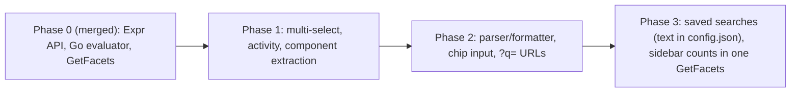

# Dashboard Query Model: Phases 1–3 Plan Overview

**Status:** All decisions made; implementation not started.
**Parent design:** [query_model_design.md](query_model_design.md) (authoritative for semantics; Phase 0 is implemented).
**Tracking:** [#15 Selector multi-select](https://github.com/tallclair/octodeck/issues/15), [#14 Saved searches](https://github.com/tallclair/octodeck/issues/14)

| Phase | Document |
|---|---|
| 1 | [query_model_phase1_multiselect.md](query_model_phase1_multiselect.md): multi-select and activity filters |
| 2 | [query_model_phase2_query_input.md](query_model_phase2_query_input.md): text query input, parser/formatter, `?q=` URLs |
| 3 | [query_model_phase3_saved_searches.md](query_model_phase3_saved_searches.md): saved searches |

Each phase document is self-contained for the agent implementing that phase: prerequisites, goals and UI spec, data/API/frontend changes, the phase's own plan decisions (P*), commit plan, and risks. This overview holds what is shared: ground rules, the user's decisions, scope and ordering, the end-state module map and the testing strategy.

---

## 1. Ground rules for the implementer

- Read first: `GEMINI.md`, `backend/GEMINI.md`, `frontend/GEMINI.md`, `CONTRIBUTING.md`, `spec.md`, and the parent design. These plans do not repeat their rules.
- **Every commit must pass `./verify.sh`** (the pre-commit hook runs it; it takes about 40 s). Never pass `--force`.
- Commit messages: Conventional Commits, imperative, **no backticks anywhere** (the `commit-msg` hook rejects them). Use single quotes for identifiers.
- Go: `goimports -w`, `testify/assert` + `testify/require`, table-driven tests, `go test ./...`.
- Frontend: Vitest (non-interactive), React Testing Library. Use the existing RPC-level harness in [`rpcTestUtils.tsx`](../../frontend/src/test/rpcTestUtils.tsx) (`createMockDaemon`, `requestsFor`, `lastRequest`) for component behaviour that depends on requests; the `describeQuery`/`itemsByQuery` helpers in [`Dashboard.rpc.test.tsx`](../../frontend/src/components/__tests__/Dashboard.rpc.test.tsx) show the pattern.
- No new runtime or dev dependencies. In particular: no drag-and-drop library, no property-testing library, no UUID library.
- Update `spec.md` at the end of each phase (the last commit of each phase lists it), following the noise rules in `GEMINI.md`.
- Implement phases in order and merge each before starting the next (§3).

---

## 2. Decisions

### 2.1 Decided by the user

| # | Decision | Implemented in |
|---|---|---|
| U1 | Phase 2 input is **option 1, tokenized chips** (Gmail/Linear style), chosen after hands-on testing of a side-by-side prototype. | Phase 2 §6 |
| U2 | The prototype (`frontend/prototype/query-input.html`, `frontend/src/prototypes/queryInput/`) is throwaway reference code. Phase 1 commit 1.0 records it in git history and commit 1.1 deletes it (its tests and lint would otherwise run on every commit); it is never imported by production code. Phase 2 reads it from git history (commit 1.0) and keeps its lessons list. | Phase 1 §9 (commits 1.0–1.1), Phase 2 §11 |
| U3 | `in:comments` is **out of scope** (no demand). | all |
| U4 | **No Go parser and no ParseQuery RPC.** TypeScript owns syntax, Go owns semantics; the wire format stays a structured `Expr` (parent §3.2–3.3). | all |
| U5 | After Phase 2 the dashboard **writes** a single `?q=` (text syntax), with `sort`, `order` and `item` kept as separate parameters. It **reads** the legacy structured parameters forever, converts them with `formatQuery`, ANDs them with any `?q=`, and rewrites the URL with `history.replaceState`. It never writes both formats. | Phase 2 §8 |
| U6 | Saved searches keep the user's original text, because option 1 chips display raw text. U13 makes the text the only stored form. | Phase 3 §3 |
| U7 | The Phase 2 query input moves from the top nav into the list header, full width; the Phase 1 chips row is removed (chips live in the input). | Phase 2 §9 |
| U8 | The input's clear (×) button clears the **whole** query, including tab chips such as `triage:acked` or `new:any`. | Phase 2 §5.3 |
| U9 | Unknown keys are **errors** (`lable:bug` is an error chip), not free text. Quote to search literally: `"foo:bar"`. Error chips must be visually distinct from negated chips (`-label:kind/bug`), and **neither uses strikethrough**. | Phase 1 §3.5, Phase 2 §3, §6.3, §7 |
| U10 | Updating a saved search's query in place is **deferred** (non-goal for Phase 3). | Phase 3 §2 |
| U11 | **Everything is multi-select except fields with a clear binary state.** Multi-select: repo, org, author, assignee, milestone, label, activity (`new:`). Binary fields stay single-select toggles or segmented controls: type (PR/Issue), tracking, draft, starred. State (open/closed/merged) is single-select because merged is a subset of closed. Triage stays as tabs. | Phase 1 §2–§3 |
| U12 | Saved-search badges depend on the saved query's **triage scope**: inbox searches show the count, orange if any match has new activity; new-activity searches show the count, always orange; acked searches show a faded count with no bubble. | Phase 3 §6.3 |
| U13 | **Saved searches live in `config.json`**, as a repeated `Config` field `{id, name, query, sort}` in display order, with the **query text, exactly as typed, as the source of truth**. The daemon stores and returns the text and never parses it; there is no stored `Expr` and no SQLite table. The frontend parses saved text with `parseQuery` when opening a search and when building badge requests, and sends the resulting `Expr` as today, so **the structured wire format does not change**. Reasons: every consumer is in the browser, which already parses text; text keeps exactly what the user typed; it is human-readable, hand-editable and backed up with `config.json`. Cost: the daemon cannot evaluate saved searches by itself (a Go parser is added if a Go-side text consumer appears, parent §3.3). This supersedes the parent's earlier "saved searches are stored as `Expr`" statement. | Phase 3 §3–§5 |
| U14 | An **all-items** saved search (`triage:all`, or `inbox,acked`) shows exactly the inbox badge (count of matching inbox items, orange if any has new activity); if no matching item is in the inbox, it shows the acked style (faded count of all matching items, no bubble). | Phase 3 §6.3 |

### 2.2 Plan decisions (P*)

Each phase document owns and lists its plan decisions; they are not repeated here:
- Phase 1 §8: P2, P3, P4, P5, P19, P20.
- Phase 2 §12: P6, P7, P9, P10.
- Phase 3 §10: P13, P16, P17, P18, P21, P22, P23, P24.

Retired numbers (not reused): P1, P8, P11 became U11, U9, U7/U8; P12, P14, P15 (SQLite storage, its migration and stored `Expr`) were superseded by U13.

### 2.3 Open questions

None.

---

## 3. Scope and ordering

| Phase | Ships | User-visible change |
|---|---|---|
| 1 | Multi-select repo, org, author, assignee, milestone, label and activity (`new:`); Merged in the State menu; component extraction from `Dashboard.tsx`. | Checkboxes in menus; multi-value chips; activity filtering; a new Assignee menu. URLs unchanged in format. |
| 2 | `parseQuery`/`formatQuery`; text as state of record; tokenized chip input with autocomplete; `?q=` URLs. | One query box with chips you can click into and edit; dropdowns stay and edit the text; URLs become `?q=is:open+label:bug`. |
| 3 | Saved searches in `config.json` (text), saved-search RPCs, saved-search and per-value new/inbox counts in `GetFacets` (one sidebar call per poll), conversion of `pinned_repos`; pin button, naming modal, sidebar edit mode. | "Pinned" sidebar section becomes "Saved searches" with scope-dependent badges; pin any query. |



Dependencies, in short (details in each phase's §1):
- Phase 2 needs Phase 1's extracted components, array-valued controls and owner-index projection.
- Phase 3 needs Phase 2's parser (saved searches are stored as text and parsed in the browser), the text state of record and clause splices, and the query input row for the pin button.

Non-goals for all three phases: `in:comments` (U3); a Go parser or `ParseQuery` RPC (U4); grouping, explicit `OR` or `NOT (...)` in the text syntax; sort in the query text (parent §4.7); per-saved-search notifications or extension badges; updating a saved search's query in place (U10); reducing polling (§3.1).

### 3.1 Deferred enhancement: reduce polling

Out of scope for Phases 1–3, by the user's decision, to keep the current changes simple. After Phase 3 the dashboard still polls every 3 s, with `GetItems`, the selector `GetFacets` and one sidebar `GetFacets` per poll (Phase 3 §6.2), each loading every item and recomputing item views. Possible follow-ups:
- **Change-driven refresh** instead of fixed polling: refetch when the daemon reports a sync or local-state change. The frontend already refetches when a sync completes, and the daemon already has a push stream (`WatchNotifications`) for the extension that could carry a "data changed" event for the dashboard.
- **Cache computed item views per sync generation** in the daemon, shared by `GetItems` and `GetFacets`, so repeated polls between syncs skip the item load and activity computation.

---

## 4. Frontend module map (end state after Phase 3)

```
frontend/src/
  components/
    Dashboard.tsx                      data wiring, mutations, layout only (target < 700 lines)
    dashboard/
      DashboardSidebar.tsx  SidebarRow.tsx  TriageTitleMenu.tsx
      FilterToolbar.tsx     StateMenu.tsx   RepoOrgMenu.tsx
      OverflowFilterMenu.tsx  MultiSelectMenu.tsx  SortMenu.tsx
    query/
      QueryInput.tsx  QueryChip.tsx  SuggestionList.tsx
    savedSearches/
      PinButton.tsx  SaveSearchModal.tsx  SavedSearchList.tsx  SavedSearchEditRow.tsx
  hooks/
    useDashboardFilters.ts  useDashboardData.ts  useMenuGroup.ts
    useStableOptions.ts     useQuerySuggestions.ts  useSavedSearches.ts
  logic/
    query/
      vocabulary.ts  predicates.ts  expr.ts  facets.ts  urlCodec.ts  legacyUrl.ts  textEdit.ts  editor.ts
      syntax/  scan.ts  parse.ts  format.ts  types.ts  index.ts
    savedSearches.ts
```

Deleted along the way: `ActiveFilterChips.tsx` (Phase 2), `textTerms.ts` (Phase 2), the prototype directories (Phase 1, commit 1.1; preserved in history by commit 1.0).

Backend additions: `backend/internal/config/{saved_searches,migrate}.go` (Phase 3), `backend/internal/server/saved_searches.go` (Phase 3), `backend/internal/query/count.go` (Phase 3). No database migrations.

---

## 5. Testing strategy (cross-phase)

| Layer | Tests |
|---|---|
| Go config | `config/saved_searches_test.go`, `migrate_test.go`, `config_test.go`: protojson round trip of `savedSearches`, normalisation of hand-edited files, validation limits, `UpdateProto` preserving the list, atomic writes, pinned-repo conversion (idempotence, backup). |
| Go query | `query/count_test.go` and `facets_test.go` using the fixtures in `fixtures_test.go`: `count`, `new_count`, `inbox_count` (per query and per facet value) agree with `q.Filter` and the `new:any`/`triage:inbox` subsets for every conformance vector. |
| Go server | `server/saved_searches_test.go` and `items_test.go` additions through the real Connect client: every saved-search error code, concurrent writers, `GetFacets` `queries` with per-query errors and limits. |
| TS pure logic | Vitest unit tests for predicates (projection, owners, activity and org/repo rules), facets, syntax (round-trip properties, golden tables, issue codes and spans), textEdit (edit locality), editor transitions, legacy URL conversion, urlCodec round trip, savedSearches helpers (`badgeScope`, count requests). |
| TS components | RTL tests for `MultiSelectMenu`, `QueryInput` (keyboard table, click-to-caret with stubbed caret APIs, select-all, clipboard, undo/redo, IME, ARIA, live region, error vs. negated chip styles), `SaveSearchModal`, `SavedSearchList` (edit mode). |
| RPC-level | `Dashboard.rpc.test.tsx` additions per commit (exact `GetItems`/`GetFacets` requests, including exactly one sidebar `GetFacets` per poll, and URL assertions). |
